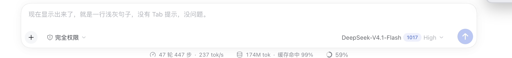

[](https://github.com/deepseek-ai/deepseek-harness)

# Suggest Question

A DeepSeek Harness plugin that guesses your next message after a turn ends and
shows it as a light ghost line inside the empty composer. Press **Tab** to fill
it into the draft; type anything to dismiss it.



## What it does

- **Host half** (`plugin/index.js`) registers `POST /suggest-question/predict`.
  On request it looks up the live Agent, builds a bounded excerpt of the
  trailing user/assistant text, and asks the Session's own model route for one
  short sentence. No tool is registered and no Session event is written.
- **Client half** (`plugin/client.js`) registers an
  `conversation.input.overlay` entry. When the Session's `running` flag falls,
  it calls the route and draws the sentence at the composer's placeholder line.
  Clicking into the composer keeps it; typing hides it; deleting the draft
  brings it back; Tab fills it with `inputActions.setDraft`.

| Situation | Result |
| --- | --- |
| A turn ends, composer empty | one prediction request; the guess appears when non-empty |
| Click into the composer | guess stays so you can still press Tab |
| Type | guess hides while the draft is non-empty |
| Delete the draft | guess shows again |
| Tab | the guess becomes the draft, then disappears |
| Next turn starts | the old guess is discarded |

## Install

```sh
dsh plugin --profile <profile> add "git+https://github.com/Dudu-0223/dsh-suggest-question.git#<commit>&path:/plugin"
```

Then add `@dudu-0223/dsh-suggest-question` to `dsh.profile.bundles` in the
profile's `package.json`, or enable it from **Plugins** in the Web GUI.
`<commit>` is a full 40-character commit SHA, so the install is reproducible.

This repository is a normal DSH plugin package: `plugin/` holds the bundle, and
no registry publish is involved.

## Cost

Each turn end costs one short auxiliary model request (80 output tokens, 8 s
deadline) on the Session's own provider/model route, with the route's lowest
reasoning effort. The request is not written to the Session log.

## Development

```sh
cd plugin
DSH_REPO=/path/to/deepseek-harness node --test test/*.test.js
```

`DSH_REPO` points at a DeepSeek Harness source checkout that provides React,
react-dom, and jsdom for the DOM cases; without it those cases are skipped and
the route tests still run.

## License

MIT
